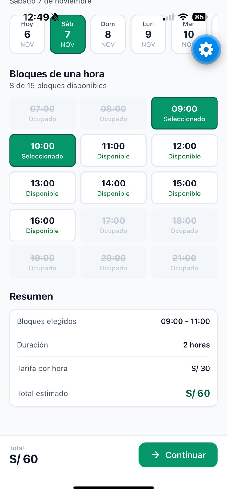
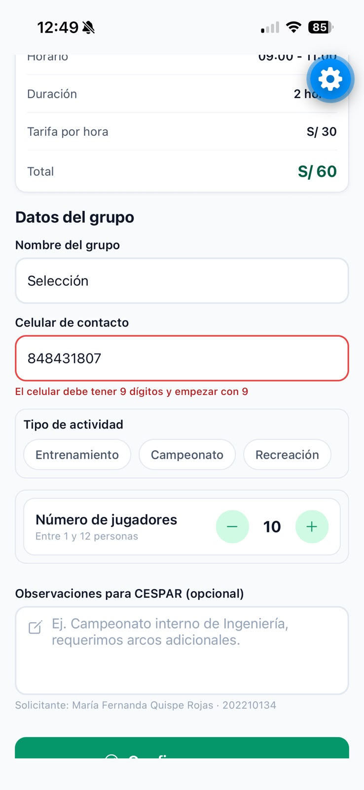
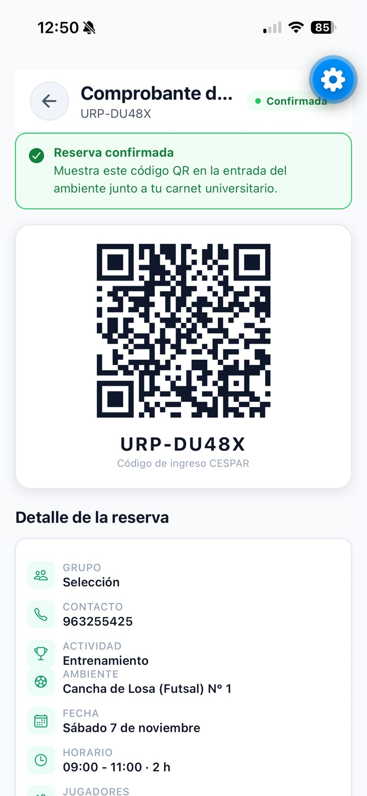
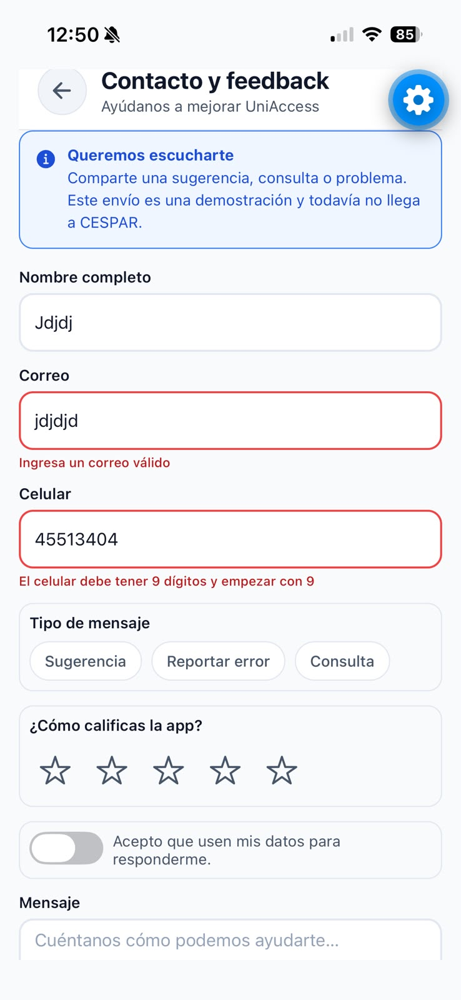
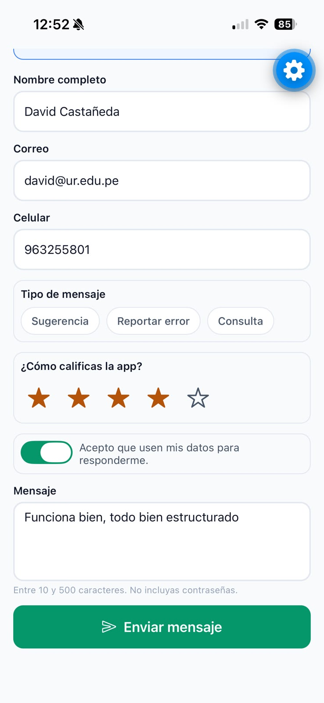
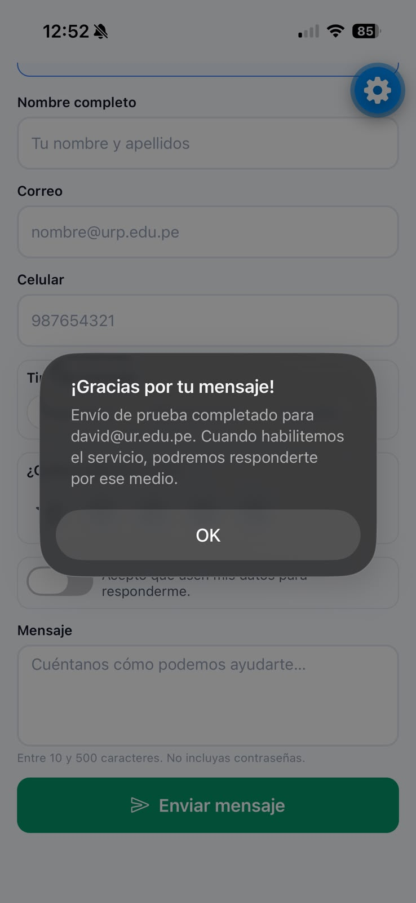
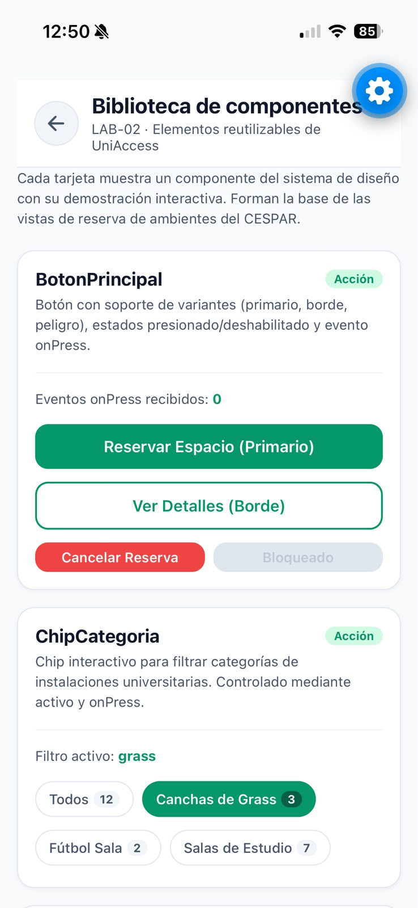

# Evidencias del LAB-05 — iPhone

Capturas originales tomadas en el iPhone y proporcionadas por el usuario el 6 de noviembre de 2026. Se recibieron nueve archivos: dos eran duplicados exactos y se conservaron siete imágenes únicas, sin editar su contenido.

## Cobertura de la entrega

| Evidencia solicitada | Estado | Captura |
|---|---|---|
| Reserva enviada vacía, con todos sus errores obligatorios | **Pendiente** | Enviar el formulario sin grupo, celular ni actividad y capturar los tres mensajes |
| Reserva con formato inválido | Recibida | [Celular inválido](02-reserva-celular-invalido.png) |
| Reserva creada correctamente | Recibida | [Comprobante confirmado](03-reserva-confirmada.png) |
| Contacto enviado vacío, con todos sus errores obligatorios | **Pendiente** | Enviar los siete campos vacíos y capturar los errores, desplazándose si es necesario |
| Contacto con formato inválido | Recibida | [Correo y celular inválidos](04-contacto-formatos-invalidos.png) |
| Contacto enviado correctamente | Recibida | [Alert de confirmación y campos restablecidos](06-contacto-confirmacion-y-reset.png) |

Las capturas con formatos incorrectos no reemplazan las dos evidencias de envío vacío que pide la rúbrica. No se afirma que se hayan probado el teclado virtual, el estado Enviando…, la cancelación o el cierre de sesión a partir de estas imágenes.

## Capturas

### 1. Selección de horarios — contexto del flujo

Se seleccionan dos bloques del sábado 7 de noviembre, de 09:00 a 11:00, con total estimado de S/ 60.

### 2. Reserva con celular inválido

El campo muestra nueve dígitos que empiezan con 8. Aparecen el borde de error y el mensaje «El celular debe tener 9 dígitos y empezar con 9».

### 3. Reserva creada correctamente

El comprobante `URP-DU48X` aparece confirmado e incluye grupo, celular, actividad, ambiente, fecha, horario y código QR.

### 4. Contacto con formatos inválidos

Se ven los mensajes específicos de correo sin formato válido y celular incorrecto, con sus bordes de error.

### 5. Datos de prueba de Contacto — complemento

Se muestran datos escritos, una calificación numérica de cuatro estrellas, el consentimiento activado y un mensaje. Esta imagen documenta los controles; la evidencia de envío correcto es el Alert de la siguiente captura.

### 6. Contacto enviado y restablecido

El Alert nativo muestra «¡Gracias por tu mensaje!» y confirma el envío de prueba. Detrás se ven los campos restablecidos y el consentimiento desactivado.

### 7. Biblioteca de componentes — complemento del LAB-02

La biblioteca sigue siendo accesible. Esta captura complementaria no reemplaza ninguna de las seis evidencias de formularios del LAB-05.

